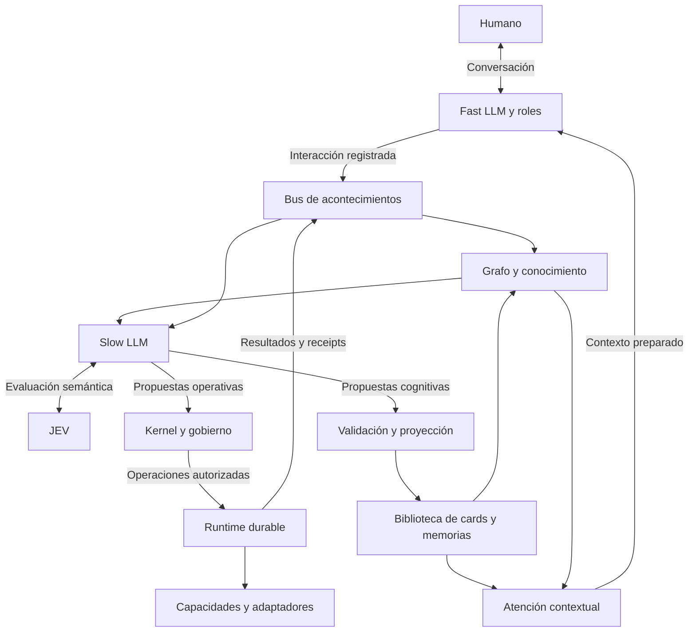

# AgntiaPro

**Infraestructura de inteligencia distribuida para compilar, operar y evolucionar empresas.**

AgntiaPro es una plataforma de software empresarial en la que el lenguaje natural es la interfaz, el conocimiento es persistente y el trabajo se ejecuta mediante un runtime gobernado. Su objetivo es que una misma infraestructura pueda operar empresas muy diferentes sin reescribir su núcleo para cada cliente.

[AgntiaPro.com](https://agntiapro.com) · [Whitepaper técnico](docs/WHITEPAPER.md) · [Whitepaper de producto](whitepaper.md) · [Campaña de convergencia](https://github.com/uniscrolliabrain-cloud/agente/tree/campaign/convergencia-operativa-12x4/docs/convergencia-operativa-12x4)

`0.2.0-beta.1` · Monorepo TypeScript / Python · Desarrollo activo

## Por qué existe

Las empresas suelen repartir su información y sus procesos entre correo, calendarios, CRM, ERP, documentos y aplicaciones especializadas. El problema no es simplemente conectar herramientas: es coordinar conocimiento, decisiones, permisos y trabajo verificable a lo largo del tiempo.

AgntiaPro combina un sistema de operación empresarial durable con una arquitectura cognitiva que observa lo sucedido, organiza conocimiento y permite conversar sobre él. No es un wrapper de chat, un enjambre de agentes autónomos ni un sustituto obligado de las aplicaciones existentes.

## Qué es hoy y qué llegará a ser

| Hoy | Dirección del producto |
|---|---|
| Motor durable, contratos tipados, tareas, capacidades, SOPs y aprobaciones existentes. | Compilación de procedimientos y capacidades específicos de cada empresa. |
| Kernel, bus, auditoría y Cognition V2 con componentes de conocimiento persistente. | Consciencia operativa integrada, capaz de observar, contextualizar y proponer mejoras. |
| Frontend empresarial, laboratorio UX, catálogo de 34 workspaces y adaptadores existentes. | Una superficie de trabajo empresarial coherente, conectada a los servicios de cada organización. |
| Roles conversacionales y canales de interacción en evolución. | Equipos digitales especializados, accesibles mediante texto, voz y visión. |
| Demo y mecanismos de provisionamiento. | Compilación y operación de numerosas empresas independientes sobre un núcleo común. |

La existencia de un módulo no implica integración completa, certificación de seguridad ni disponibilidad comercial. La prioridad actual es cerrar y verificar el sustrato común.

## Arquitectura

**Slow propone; el kernel valida y autoriza; el runtime ejecuta; Fast comunica.**



Diagrama de arquitectura objetivo; no representa una certificación del wiring actual. Observabilidad, identidad, aislamiento, políticas y trazabilidad atraviesan los circuitos representados.

### Núcleo operativo

El runtime administra trabajo durable, estados, leases, checkpoints, reintentos y recuperación. Las capacidades declaran entradas, salidas, riesgos, permisos y efectos. El kernel conserva la autoridad sobre las propuestas; las operaciones sujetas a aprobación humana no pueden eludirla. Los resultados ambiguos de proveedores deben reconciliarse antes de repetir efectos externos.

El bus distribuye acontecimientos tipados y permite reconstruir causalidad. Los contratos se validan en las fronteras. Los objetivos de seguridad incluyen deny-by-default, fail-closed, idempotencia, aislamiento por tenant y evidencia verificable.

### Consciencia operativa

La expresión designa la organización funcional del conocimiento y la observación del propio sistema, no una afirmación de experiencia subjetiva.

- **Slow LLM:** comprende, relaciona, interpreta y propone operaciones o representaciones cognitivas estructuradas.
- **JEV:** evaluación y clasificación semánticas; nunca autoridad de ejecución.
- **Grafo, RAG y atención:** organizan relaciones, recuperan conocimiento autorizado y seleccionan contexto pertinente.
- **Cards:** unidades persistentes de conocimiento con metadata, revisión, procedencia y estado epistémico. Pueden representar observaciones, hipótesis, patrones o estructuras reutilizables de tipo skill; no son necesariamente visuales ni ejecutables.
- **Memorias:** episódica, semántica, procedimental, autobiográfica y de trabajo.
- **Fast LLM:** recibe contexto preparado e interpreta la conversación para comunicar al humano. No elabora propuestas operativas ni ejecuta herramientas.

La metacognición observa y reorganiza los procesos de conocimiento. Los receipts deterministas sustentan hechos verificados; una inferencia o clasificación no se convierte automáticamente en un hecho ni concede permisos.

### Roles e interacción

LAIA, Marcos y otros personajes representan roles especializados mediante prompts, RAG y fine-tuning cuando corresponda. No son runtimes autónomos. El trabajo real pertenece al sistema común; los roles lo explican desde diferentes perspectivas, con personalidad y conocimiento de oficio, sin inventar acciones.

El objetivo de producto incluye conversación por texto, voz y visión, interfaces empresariales y coordinación entre humanos. Estas superficies no deben crear canales alternativos de autoridad.

## Compilación empresarial: visión de producto

Compilar una empresa significa configurar su conocimiento, procesos, políticas, roles, conexiones y superficies de trabajo sobre el núcleo existente.

La visión del Arquitecto descrita en el whitepaper es producir artefactos declarativos — procedimientos, capacidades, schemas, skills y vistas — mediante plantillas, generación acotada, validación y pruebas en sandbox. Una propuesta aprobada puede incorporarse al catálogo reutilizable. Cuando una necesidad excede los contratos, se escala al operador humano; el compilador no reescribe libremente el motor.

El producto futuro incluye equipo digital, planificación, centro de control, aprobaciones, documentos y conocimiento, integraciones comerciales y administrativas y actualización tecnológica continua. Ejemplos de aplicación son soporte multicanal, agenda, gestión de leads, facturación y operaciones internas.

AgntiaPro Demo sirve como dogfooding y referencia de integración. No define las ontologías ni los procesos de todos los clientes.

## Etapa actual: convergencia del core

La prioridad es consolidar kernel, runtime, bus, grafo, attention vectors, cards, metacognición, memorias, RAG, Slow, JEV, Fast, observabilidad, voz y visión. El middleware de ciberseguridad ya figura como dependencia del monorepo y constituye una superficie de integración.

No es la etapa de construir nuevos agentes especializados, SOPs empresariales, dominios, ontologías de empresa ni branchear UX. Las capacidades existentes pueden servir para certificar el núcleo.

| Frente | Responsabilidad |
|---|---|
| Trans01 | Kernel, runtime, autoridad, causalidad y receipts. |
| Trans02 | Cognition e inteligencia distribuida. |
| Trans03 | Proveedores, puertos y adaptadores. |
| Trans04 | Infraestructura, observabilidad y certificación. |

La [campaña de convergencia 12×4](https://github.com/uniscrolliabrain-cloud/agente/tree/campaign/convergencia-operativa-12x4/docs/convergencia-operativa-12x4) es la referencia de coordinación, pendiente de reconciliar con las aclaraciones actuales del fundador. Verificar la grafía y autorización de cada rama antes de trabajar.

## Repositorio

| Ruta | Responsabilidad |
|---|---|
| [apps/server](apps/server) | API Hono, runtime, kernel, Cognition V2, workers y persistencia. |
| [apps/web](apps/web) | Aplicación React empresarial. |
| [apps/site](apps/site) | Sitio comercial. |
| [apps/ui-lab](apps/ui-lab) | Laboratorio de interfaces y prototipos. |
| [apps/worker](apps/worker) | Browser worker Playwright. |
| [apps/computer](apps/computer) | Sandbox computer y skills Python. |
| [packages/domain](packages/domain) | Contratos y schemas Zod. |
| [packages/integrations](packages/integrations) | Integraciones y adaptadores. |
| [packages/backends](packages/backends) | Adaptadores de backend. |
| [packages/workspaces](packages/workspaces) | Catálogo de workspaces empresariales. |
| [tests](tests) · [scripts](scripts) | Pruebas, auditorías, gates y operaciones. |

**Stack:** Node.js ≥22.6, pnpm 11.19, TypeScript, Hono, React/Vite, Zod, AG-UI/CopilotKit, RxJS, PGlite/Postgres, Playwright y Docker.

## Desarrollo local

Desde la raíz, con Node y pnpm instalados:

```bash
pnpm install
cp .env.example .env
pnpm dev:all
```

Revisar [.env.example](.env.example) antes del arranque. Para desarrollo aislado, usar el modo sample cuando corresponda. Para servicios reales, configurar base de datos, autenticación y proveedores según el entorno; nunca versionar credenciales.

| Comando | Finalidad |
|---|---|
| `pnpm dev` | API en desarrollo. |
| `pnpm dev:worker` | Worker durable. |
| `pnpm dev:cognition-worker` | Worker Cognition V2. |
| `pnpm dev:browser` | Browser worker. |
| `pnpm typecheck` | Comprobación de tipos. |
| `pnpm test` | Suite de pruebas. |
| `pnpm test:cognition-v2` | Pruebas Cognition V2. |
| `pnpm beta:smoke` | Smoke test. |
| `pnpm verify:slice` | Verificación del vertical slice sin proveedores reales. |
| `pnpm gate` | Gate general. |
| `pnpm gate:cognition-v2` | Gate cognitivo. |
| `pnpm build:server` | Compilación del servidor. |

Los scripts están definidos en [package.json](package.json). No se afirma aquí que los gates estén actualmente en verde.

## Despliegue y seguridad

PGlite permite desarrollo local; Postgres es la ruta de producción. El despliegue aislado por cliente es la base operativa descrita en los whitepapers; el modo compartido requiere certificación de aislamiento y RLS. Cognition V2 bloquea explícitamente el modo compartido cuando no está certificado.

La separación API/worker, backups, recuperación, gestión de secretos, observabilidad y verificación de side effects forman parte de los requisitos de operación. No habilitar producción ni efectos externos reales basándose únicamente en la existencia de código o variables de entorno.

## Documentación y contribución

- [Producto](docs/02-producto), [arquitectura](docs/03-arquitectura), [operaciones](docs/04-operaciones), [desarrollo](docs/05-desarrollo), [API](docs/06-api) e [integraciones](docs/07-integraciones).
- [Whitepaper integral](docs/WHITEPAPER.md) y [whitepaper de síntesis](whitepaper.md): antecedentes de octubre de 2026; contienen decisiones y estados históricos que deben contrastarse con el código y esta definición actual.
- [Auditorías](docs/auditoria-integral-30-angulos) y [evidencias](docs/verification).
- [AgntiaPro Demo](apps/ui-lab/docs/agntia-demo): contexto empresarial de referencia.

Para contribuir, contrastar siempre canónica, campaña técnica y código real. Preservar capacidades existentes; identificar contratos, consumidores y wiring antes de modificar. Los patchsets deben incluir pruebas positivas, negativas y de recuperación, así como rollback. Objetivo técnico y documental superior a 9/10. Ejecutar macroturnos hasta las barreras autorizadas; registrar bloqueos y continuar trabajo independiente seguro. Los cambios de arquitectura canónica requieren aprobación del fundador.

## Licencia y mantenimiento

Repositorio privado de uniscrolliabrain-cloud. Consultar [LICENSE](LICENSE) para los términos del código. El acceso al repositorio y la oferta comercial son cuestiones distintas.

