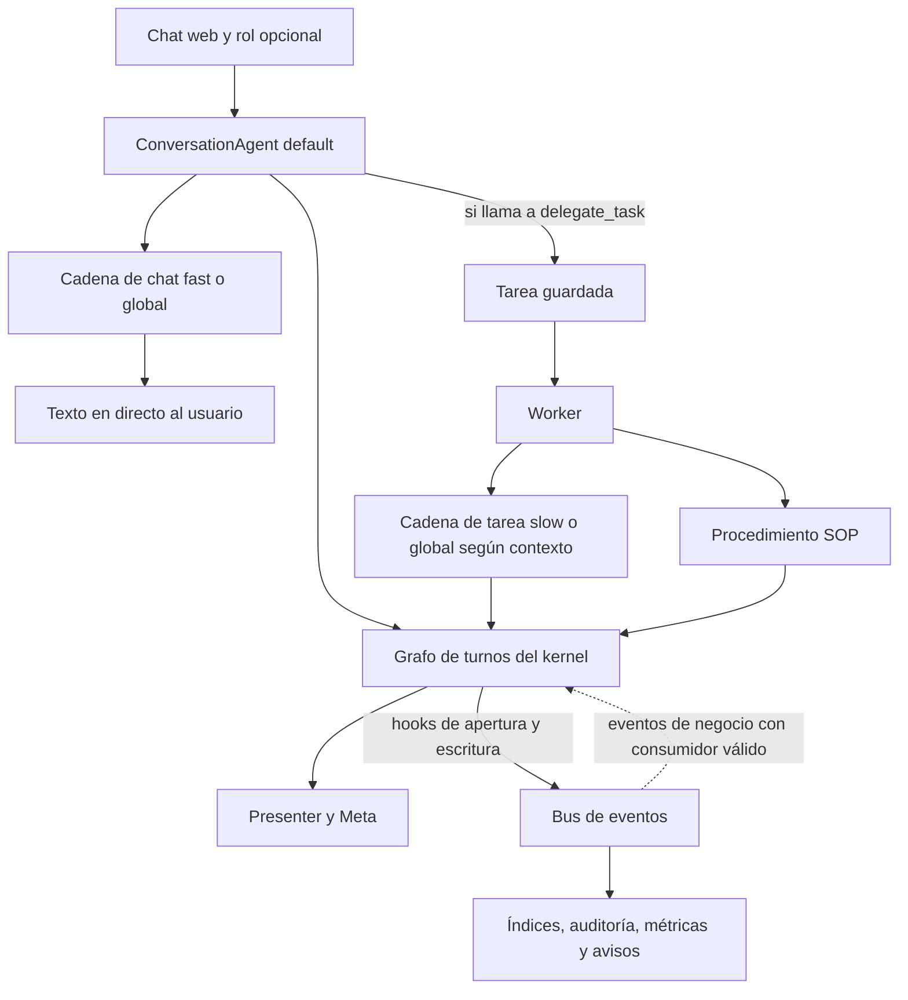

# Auditoría de agentes, LLM y kernel cognitivo

> Para la propuesta posterior de integración de Laia en el piloto y el contexto del grafo, consulta [estado del vertical](./operacion/ESTADO-VERTICAL-LAIA-Y-DATOS.md). Esta auditoría conserva su SHA original.

**Repositorio** `uniscrolliabrain-cloud/agente` · **Fecha** 4 de noviembre de 2026 · **Base** [`4f81f22`](https://github.com/uniscrolliabrain-cloud/agente/commit/4f81f2293b67048ec4f6a32801f5940439b832cf), rama `main`.

## Resumen

Laia sigue entrando por `ConversationAgent`, en el archivo que recordabas. Laia es el nombre del asistente y una identidad por defecto en los prompts. El modelo real sale de configuración y puede variar entre conversación, tarea, rol y fallback.

| Unidad auditada | Cantidad en la base | Cómo interpretarla |
|---|---:|---|
| Registro público de CopilotKit | **1** | Clave `default` en `/api/copilotkit`. Selecciona implementación local o remota. |
| Implementación conversacional local | **1** | `ConversationAgent`, con ejecución de muestra o inferencia real. |
| Alternativa conversacional remota | **1** | `HttpAgent` de AG-UI, seleccionada en vez del agente local con `AGENT_BACKEND=agui`. Su implementación vive fuera del repo. |
| Puntos de construcción de agentes LLM locales | **7** | Siete apariciones de `new BuiltInAgent` en producción. Cada una puede instanciarse múltiples veces y compartir modelo con otras. |
| Roles en el catálogo base | **16** | Definiciones de negocio, con identidad, ámbito y referencias a procedimientos. |
| Personas empaquetadas del tenant `default` | **12** | Un subconjunto de esos roles con `persona.json` y `stats.json` propios. |
| Persona de ejemplo | **1** | Laia, bajo `clientes/_example`. |
| Autores del grafo | **3** | `UserAuthor`, `FastAuthor`, `SlowAuthor`. Registran contenido y procedencia de un turno. |
| Proveedores admitidos por el esquema del kernel | **4** | Google, Anthropic, OpenAI y OpenRouter. El soporte operativo depende del camino de inferencia. |
| Cliente de embeddings | **1** | Google, con identificador fijo en código. |

Los 16 roles incluyen las 12 personas empaquetadas. Los siete puntos de inferencia son sitios del código, no siete despliegues de modelos. El número efectivo de identificadores de modelo y de instancias simultáneas depende del entorno, las tareas y la configuración de cada tenant.

## 1. Origen y evolución

El [el proyecto original de CopilotKit](https://github.com/CopilotKit) ofrece chat AG-UI, tareas persistentes y herramientas para navegador, documentos y ordenador. El primer commit del repo auditado, [`d3e39dc`](https://github.com/uniscrolliabrain-cloud/agente/commit/d3e39dc368b3433f31302adeca22771591490c44), ya se describe como una reconstrucción Enterprise. Esa raíz sirve de línea base para atribuir cambios internos. El historial disponible carece de un ancestro de CopilotKit que permita atribuir con precisión cada línea del snapshot inicial.

| Hito | Evidencia |
|---|---|
| 24 sep. · Importación inicial | `d3e39dc` ya trae `ConversationAgent`, un agente por defecto, muestra determinista y el camino que pasa `config.model` al runtime. También existe ejecución de tareas con modelo. |
| 24 sep. · Cadena de modelos | `2a58275` introduce `engine/model-chain.ts`. La selección deja de depender de un único intento. |
| 25 sep. · Inferencia dentro de procedimientos | `a163ae5` añade el paso SOP `llm_generate`. |
| 27 sep. · Contexto persistente | `7fabd87` y `a9e9924` registran la incorporación de RAG, memoria, proyectos e hilos en la historia interna. |
| 30 sep. · Roles de Business OS | `bdd4f73` añade la infraestructura inicial de roles. |
| 1 oct. · Kernel | `d9d5066` añade el kernel con grafo, vistas, progreso, auditoría y autores. `7a8bcbf` amplía reglas, consolidación, capacidades y almacenamiento. |
| 2 oct. · Configuración y Business OS | `c02b4e2` completa piezas de `ProviderSpec` y resolutores. `aa826bc` incorpora contratos y guardrails multi-tenant. |
| Octubre · Ciclo de objetivos | `07aa9e1` conecta el orquestador, el aprendizaje y el feedback. |
| 7 oct. y evolución posterior · Personas | `d4758ed` introduce Laia como plantilla. `5090b98` incorpora a la línea auditada Laia, 12 personas y el trabajo entre personas. |
| 12 oct. · Observabilidad cognitiva | `717496d` añade consumidores de eventos y meta-hints. |
| 30 oct. · Estado de main | `4f81f22` incorpora documentación de la fase cero compartida. El inventario se ciñe al código presente en ese árbol. |

Para inspeccionar el punto de partida, ejecutar `git show d3e39dc:apps/server/src/engine/conversation.ts`. El diff desde esa raíz amplía sustancialmente `conversation.ts` y `model.ts`, y añade el árbol `apps/server/src/kernel/`.

## 2. Inventario de inferencia

Las rutas de esta tabla son relativas a [`apps/server/src/engine/`](https://github.com/uniscrolliabrain-cloud/agente/tree/4f81f2293b67048ec4f6a32801f5940439b832cf/apps/server/src/engine). Las líneas corresponden al commit auditado.

| Punto | Archivo y línea | Función | Selección efectiva |
|---|---|---|---|
| 1 | [`conversation.ts:771`](../apps/server/src/engine/conversation.ts#L771) | Chat interactivo, herramientas, stream AG-UI y contexto enriquecido. | Global por defecto. Con fast utilizable, fast y luego slow si ambos tienen clave declarada. Con fast solo, agrega la cadena global. |
| 2 | [`model.ts:483`](../apps/server/src/engine/model.ts#L483) | `executeModelTask`, ejecutor de tareas delegadas. Hasta 16 pasos del agente, con herramientas de tarea. | Modelo de rol si existe, luego slow y global/fallback. La configuración de tenant se consulta en este bloque si existen `roleId` y contexto de kernel. |
| 3 | [`model.ts:670`](../apps/server/src/engine/model.ts#L670) | `generateText`, generación auxiliar. Consumida por el ejecutor de herramientas en `execution/tool-executors.ts`. | Global/fallback. |
| 4 | [`planner/llm-planner.ts:52`](../apps/server/src/engine/planner/llm-planner.ts#L52) | Genera un plan a partir del objetivo, contexto y catálogo de capacidades. Tiene `StubPlanner` como respaldo en el cableado de servicio. | Global/fallback. |
| 5 | [`planner/replanner.ts:59`](../apps/server/src/engine/planner/replanner.ts#L59) | Propone una revisión a partir del plan previo y del fallo. | Global/fallback. |
| 6 | [`verification/llm-verifier.ts:52`](../apps/server/src/engine/verification/llm-verifier.ts#L52) | Añade verificación basada en modelo al verificador determinista. | Global/fallback. |
| 7 | [`sop-executor.ts:757`](../apps/server/src/engine/sop-executor.ts#L757) | Paso SOP `llm_generate`, una generación de texto sin herramientas. Responde 503 si falta `config.model`. | Global/fallback. |

### Cómo se llega a cada ruta

- [`agent.ts`](../apps/server/src/agent.ts) monta el registro `default` en CopilotKit. El backend `sample` usa el mismo `ConversationAgent` por una rama de respuestas y acciones predefinidas. En `model`, usa el camino de inferencia local. `agui` construye un `HttpAgent` con `AGENT_URL` y token opcional. También hay una superficie de conversación propia en [`app.ts`](../apps/server/src/app.ts) y su cliente web en [`apps/web/src/api/conversation.ts`](../apps/web/src/api/conversation.ts).
- El chat combina identidad, datos del espacio, memorias, hints, contexto del rol y herramientas. Puede responder en el mismo turno o encaminar trabajo durable. La heurística `shouldDelegateToSlow` está al final de [`conversation.ts`](../apps/server/src/engine/conversation.ts#L1104). Una delegación y un fallback son decisiones distintas. La primera crea o encamina trabajo, mientras que el segundo intenta servir la misma inferencia con otro modelo.
- [`worker.ts`](../apps/server/src/engine/worker.ts) se ocupa de la ejecución durable, el actor que ejecuta y los resultados persistidos. [`service.ts`](../apps/server/src/engine/service.ts#L2051) despacha hacia el ejecutor de modelo cuando corresponde. Los procedimientos tienen su propio ejecutor y pueden combinar pasos deterministas, herramientas y generación puntual.
- La ruta de objetivos en [`engine/routes.ts`](../apps/server/src/engine/routes.ts#L350) llama al [orquestador](../apps/server/src/engine/orchestrator/orchestrator.ts). Este planifica, comprueba capacidades, ejecuta y verifica. Puede ejecutar un plan revisado hasta tres veces. La ejecución se delega al executor y al registro de capacidades. El orquestador coordina los puntos 4 a 6.
- [`AgentRuntimeManager`](../apps/server/src/engine/agents/runtime.ts) asigna ID, tenant, propietario, rol, tarea y correlación a cada runtime efímero. Mantiene un mapa en memoria y emite eventos de alta, éxito y fallo. `spawn` registra identidad y ciclo de vida. Las llamadas de modelo ocurren en los siete sitios anteriores.
- [OpenBot](../packages/backends/src/openbot.ts) tiene un adaptador de transporte. La vista de [workspace](../apps/server/src/workspace.ts#L322) lo declara sin cablear en este build. El mock de [demo](../apps/server/src/demo/model.ts) simula un endpoint compatible para pruebas y demostración. Los workers de navegador y ordenador aportan herramientas, con su ejecución fuera del recuento de agentes LLM.

## 3. Identidades, roles y personas

Fuente de los nombres y del universo de roles. [`clientes/_base/agentes.json`](../clientes/_base/agentes.json)

| ID | Nombre de catálogo | Perfil empaquetado en `default/personas` |
|---|---|---|
| `direccion` | Alex | Sí |
| `comercial` | Leo | Sí |
| `atencion` | Sofia | Sí |
| `administrativo` | Carmen | Sí |
| `finanzas` | Victor | Sí |
| `marketing` | Bruno | Sí |
| `contenido` | Lola | Sí |
| `operaciones` | Omar | Sí |
| `compras` | Raul | Sí |
| `rrhh` | Elena | Sí |
| `legal` | Martin | Sí |
| `compliance` | Clara | Sí |
| `investigacion` | Nico | Solo catálogo base en este recuento |
| `calidad` | Sara | Solo catálogo base en este recuento |
| `it` | Teo | Solo catálogo base en este recuento |
| `producto` | Valeria | Solo catálogo base en este recuento |

- **Catálogo**. Los registros describen identidad, ámbito, objetivos, hechos y SOP asociados. Hay además un fichero de catálogo en `clientes/_example/agentes.json`. La tabla cuenta IDs del catálogo base una sola vez.
- **Persona**. El loader valida `persona.json` y `stats.json`. El registro indexa por tenant. `resolveSkin` combina identidad, estadísticas y estado temporal y puede refrescar estadísticas desde tareas. La API de personas se monta en `/api/agent-personas`. [Índice de default](../clientes/default/personas/_index.json) · [Laia](../clientes/_example/personas/laia/persona.json) · [Registro y API](../apps/server/src/engine/agents/personas)
- **Rol durante la ejecución**. `roleId` condiciona el prompt y memorias que entran en contexto. Las tareas pueden llevar `assignedTo` y `state.roleId`. El modelo de un rol es opcional y se resuelve en el ejecutor compartido de tareas. El perfil de persona y el actor autorizado son entidades distintas. [Asignación](../apps/server/src/engine/routes.ts#L243) · [Memoria de rol](../apps/server/src/engine/memory.ts#L147) · [Gobernanza](../apps/server/src/engine/agents/governance.ts)
- **Instalación efectiva**. El arranque en `index.ts` carga `default` y `_example` en un registro local al bloque. `createApp` crea otro registro para su API. El intento secundario de la API con `bootstrapPersonas(registry, "default", "clientes/_example")` compone `clientes/_example/default/personas`, mientras que Laia está en `clientes/_example/personas/laia`. Un log de arranque que incluya Laia acredita esa carga inicial, pero hace falta comprobar el registro de la API para saber qué perfiles ofrece. [Arranque](../apps/server/src/index.ts#L47) · [Registro de la app](../apps/server/src/app.ts#L117) · [Composición de ruta](../apps/server/src/engine/agents/personas/bootstrap.ts)

## 4. Configuración de modelos y proveedores

| Capa | Variables o campos | Efecto |
|---|---|---|
| Global | `MODEL`, `GEMINI_MODEL`, `MODEL_FALLBACK` | `MODEL` explícito gana. Sin él, `GEMINI_MODEL` puede producir un spec `google/…`. El fallback explícito tiene prioridad. |
| OpenRouter global | `OPENROUTER_API_KEY`, `OPENROUTER_MODEL`, `OPENAI_BASE_URL` | El código prepara un endpoint compatible con OpenAI y un spec de fallback con prefijo `openai/`. |
| Kernel por tenant | `fast`, `slow`, `embeddings`, `roles`, `maxSteps` | Resolutores de base de datos y entorno. Un `ProviderSpec` declara proveedor, modelo, clave y URL base opcional. El resolver de entorno trae defaults de Google para fast y slow. |
| Embeddings | `GOOGLE_API_KEY` o `GEMINI_API_KEY`, más override opcional de clave | Cliente HTTP separado con el modelo fijado a `text-embedding-004`. RAG pasa una clave cuando la tiene. La llamada de indexación de memoria usa la configuración global. |
| AG-UI remoto | `AGENT_BACKEND=agui`, `AGENT_URL`, `AGENT_TOKEN` | Delegación de conversación a otro servicio. La selección interna de LLM de ese servicio queda fuera del árbol auditado. |

[Configuración global](../apps/server/src/config.ts) · [Esquema de proveedor](../apps/server/src/kernel/config/provider-spec.ts) · [Resolutor de entorno](../apps/server/src/kernel/config/env-resolver.ts) · [Resolutor de base de datos](../apps/server/src/kernel/config/database-resolver.ts) · [Cliente de embeddings](../apps/server/src/engine/embeddings.ts)

El fallback compartido ignora eventos de intentos sustituidos y cambia de spec cuando el fallo ocurre antes de salida visible. La primera salida de texto o herramientas fija el intento. Hay un temporizador de primera respuesta, un circuito indexado por prefijo de proveedor y un contador de concurrencia por proveedor. El chat pasa explícitamente un timeout de 2 segundos por defecto. Las tareas tienen un plazo exterior de cinco minutos. Los procedimientos de generación puntual tienen uno de dos minutos. [Cadena](../apps/server/src/engine/model-chain.ts) · [Chat](../apps/server/src/engine/conversation.ts#L769) · [Tareas](../apps/server/src/engine/model.ts#L549) · [SOP](../apps/server/src/engine/sop-executor.ts#L771)

## 5. Kernel cognitivo y aprendizaje

| Capa | Comportamiento observado | Dónde seguirlo |
|---|---|---|
| Entrada y ámbito | `KernelContext` transporta tenant, propietario, actor, rol, solicitud y, cuando aplica, persona. El kernel abre turnos y dispone de apertura idempotente. | [Contexto](../apps/server/src/kernel/context/kernel-context.ts) · [Kernel](../apps/server/src/kernel/kernel.ts#L76) |
| Representación | El turno contiene `Thought` estructurados. El chat registra entrada con `UserAuthor` y respuesta con `FastAuthor`. El SOP usa `SlowAuthor` para registros de razonamiento operativo o delegación. Son escrituras del sistema sobre los datos que recibe cada autor. | [Thought](../apps/server/src/kernel/graph/thought.ts) · [Autores](../apps/server/src/kernel/authors) · [Escritura fast](../apps/server/src/engine/conversation.ts#L1026) · [Escritura slow](../apps/server/src/engine/sop-executor.ts#L118) |
| Atención y presentación | Hay cálculo de atención y reglas sobre el grafo, lectura de vistas y progreso y una capa de presentación con SSE. Meta genera señales que pueden entrar en el contexto conversacional. | [Grafo](../apps/server/src/kernel/graph) · [Observadores](../apps/server/src/kernel/observers) · [Uso de meta-hints](../apps/server/src/engine/conversation.ts#L636) |
| Persistencia | La app cablea stores durables para turnos y auditoría sobre su DB. `Kernel` registra apertura, escritura y cierre. Hay emisión de eventos e índices/consumidores para inspección, métricas y notificaciones. | [Cableado](../apps/server/src/app.ts#L188) · [Store del grafo](../apps/server/src/kernel/graph/store-store.ts) · [Store de auditoría](../apps/server/src/kernel/audit/store-store.ts) · [Suscriptores](../apps/server/src/kernel/subscribers) |
| Consolidación | El servicio contiene consolidación al cerrar el turno y un proceso de mantenimiento para turnos cerrados. La operación de consolidación agrupa y destila artefactos del grafo. | [Consolidación](../apps/server/src/kernel/graph/consolidate.ts) · [Disparo y mantenimiento](../apps/server/src/engine/service.ts#L700) |
| Promoción | `Promoter` evalúa material de turnos para destinos persistentes. El servicio contiene un camino de promoción para supervisor que escribe memorias a partir de los destinos devueltos. | [Promoter](../apps/server/src/kernel/graph/promote.ts) · [Servicio](../apps/server/src/engine/service.ts#L2382) |
| Memoria operativa | Al completar pasos SOP, el servicio puede incorporar hechos curados. `LearningService` limpia, deduplica, limita a 20 hechos por llamada y registra la procedencia del SOP. La memoria se recupera para enriquecer inferencias posteriores. | [Fin de SOP](../apps/server/src/engine/sop-executor.ts#L483) · [LearningService](../apps/server/src/engine/learning.ts) · [Memoria](../apps/server/src/engine/memory.ts) |
| Aprendizaje por objetivos | `LearningObserver` guarda hechos, frecuencias de planes y lecciones de fallos. Después de cinco éxitos de una firma escribe una propuesta procedimental con estado `proposed`. El registro contiene la firma del plan. | [Observador](../apps/server/src/engine/learning/observer.ts) · [Orquestador](../apps/server/src/engine/orchestrator/orchestrator.ts) |
| Feedback | Hay captura de feedback, scoring y almacén de meta-hints. El servicio arma contexto para el chat con hints recuperados. | [Feedback](../apps/server/src/engine/feedback) · [Ensamblado en servicio](../apps/server/src/engine/service.ts#L1046) |
| RAG | Documentos y memoria tienen rutas de indexación/recuperación. El cliente de embeddings es compartido y la integración recupera contexto para consumo por el runtime. | [RAG](../apps/server/src/engine/rag.ts) · [Rutas](../apps/server/src/rag-routes.ts) · [Contexto](../apps/server/src/engine/context) |

El aprendizaje observable consiste en escribir y recuperar estado de aplicación: memoria, evidencias, firmas, propuestas y señales para prompts posteriores. La búsqueda en las rutas de inferencia y aprendizaje no mostró entrenamiento ni actualización de pesos. El grafo expone representaciones de aplicación y trazas de ejecución. Sus autores reciben datos de los distintos caminos y los materializan como nodos.

## 6. Hallazgos y comprobaciones prioritarias

| Prioridad | Hallazgo de inspección estática | Comprobación que lo delimita |
|---|---|---|
| Alta | **El modelo por tenant se elige sin pasar su conexión completa al runtime.** Chat y tarea leen `apiKey` para decidir si incorporan un spec, pero crean `BuiltInAgent` con el string de modelo. En esos puntos no se trasladan `apiKey` y `baseUrl` del tenant. Una prueba con solo credenciales por tenant puede dar un resultado distinto de otra con credenciales globales. | Usar dos endpoints mock y claves distintas para dos tenants. Verificar endpoint y encabezado por inferencia en los sitios 1 y 2. [Chat](../apps/server/src/engine/conversation.ts#L731) · [Tarea](../apps/server/src/engine/model.ts#L482) |
| Alta | **El control de disponibilidad es global.** `agentConfigured` en modo modelo exige `config.model` y alguna de tres claves globales. Una configuración exclusivamente fast/slow puede superar los requisitos del resolver y fallar en este control previo. | Arrancar con fast de tenant y sin `MODEL` ni claves globales. Comparar salud, chat y tarea. [Control](../apps/server/src/agent.ts#L13) · [Uso en app](../apps/server/src/app.ts#L995) |
| Alta | **La selección fast/slow cambia según la ruta.** Chat con fast y slow construye esa pareja, sin anexar el fallback global. Una tarea sin rol omite la consulta de tenant en su cadena. Los sitios 3 a 7 pasan solo configuración global. | Simular fallo inicial en cada combinación de rol y configuración. Registrar el orden real de intentos. [Cadena](../apps/server/src/engine/model-chain.ts#L34) · [Chat](../apps/server/src/engine/conversation.ts#L713) · [Tarea](../apps/server/src/engine/model.ts#L515) |
| Alta | **El contador de concurrencia no tiene una liberación uniforme.** En `runWithModelFallback` la liberación aparece en timeout y error. La finalización normal, el cambio por evento `RUN_ERROR` y la cancelación carecen de esa llamada en sus bloques. Tras varias llamadas exitosas, el contador puede sesgar la selección hacia un fallback. El límite tampoco evita el último intento si ya no hay fallback. | Repetir más llamadas exitosas que el límite, luego repetir con cancelaciones y errores previos a salida. Inspeccionar contador y modelo elegido. [Implementación](../apps/server/src/engine/model-chain.ts) |
| Media | **La expectativa de latencia está repartida.** El chat pasa 2 s por defecto, mientras que el wrapper usa 45 s de primera respuesta sin override y deja de medir ese plazo al aparecer la primera salida visible. La constante local de 120 s del wrapper no se usa para imponer un plazo total en ese bloque. | Simular primera salida a 2,1 s y un stream que se detiene después del primer fragmento. Medir errores y cancelación. [Chat](../apps/server/src/engine/conversation.ts#L769) · [Wrapper](../apps/server/src/engine/model-chain.ts) |
| Media | **El esquema de embeddings promete más campos que los consumidos.** El cliente permite override de clave, pero la URL y el modelo son constantes. Configurar otro proveedor, modelo o URL en `ProviderSpec` no cambia esa petición HTTP. | Probar una configuración de embeddings con endpoint mock y comparar los destinos de indexación de memoria y RAG. [Cliente](../apps/server/src/engine/embeddings.ts) · [RAG](../apps/server/src/engine/rag.ts#L168) |
| Media | **Los dos bootstraps de personas pueden divergir.** El registro que produce el log de arranque y el registro HTTP tienen vidas separadas. La ruta calculada para el ejemplo en la app tampoco coincide con el árbol versionado. | Arrancar desde un directorio limpio, listar personas por tenant y comparar resultados con el log de `index.ts`. [Arranque](../apps/server/src/index.ts#L47) · [App](../apps/server/src/app.ts#L117) |
| Media | **El observador aprende del estado de ejecución que recibe.** Se invoca después de verificar, pero recibe `outcome`, sin el veredicto como argumento. Un resultado de ejecución marcado `achieved` puede contarse como éxito aunque la verificación discrepe, según el estado que le pase el orquestador. La lectura seguida de escritura de contadores también merece una prueba con concurrencia. | Forzar un resultado de ejecución favorable con verificación negativa y revisar `learning-facts` y `learning-patterns`. Repetir con ejecuciones simultáneas de igual firma. [Llamada](../apps/server/src/engine/orchestrator/orchestrator.ts#L115) · [Contadores](../apps/server/src/engine/learning/observer.ts) |
| Media | **Modelo del rol y permisos del actor son controles separados.** La selección de prompt o modelo por rol debe rastrearse junto a los controles de actor, tenant y política. Una prueba de contenido del prompt por sí sola aporta evidencia parcial del aislamiento. | Probar asignación entre tenants y comparar actor, capacidad, recursos leídos, memorias recuperadas y eventos. [Worker](../apps/server/src/engine/worker.ts#L372) · [Gobernanza](../apps/server/src/engine/agents/governance.ts) · [Contexto](../apps/server/src/engine/context) |

## 7. Alcance, verificación y reproducción

Se tomó el árbol completo de `main` con **2.073 rutas versionadas** y **218 commits alcanzables** desde la base. Se buscaron puntos de inferencia y adaptadores en el código versionado, después se siguió el cableado de servidor, web, worker, paquetes, configuración y catálogos. Las ramas de trabajo paralelas quedan fuera de los recuentos. La referencia upstream y el primer commit interno se usan para contextualizar la evolución, con el límite de atribución descrito arriba.

La auditoría es estática. Los conteos describen definiciones y rutas presentes en Git. La disponibilidad de un modelo comercial, el número de tenants y personas cargadas, las credenciales reales, las llamadas externas, el comportamiento bajo carga y el estado de despliegue requieren evidencia de ejecución. Se localizaron pruebas versionadas de [API de agentes](../tests/agent-api.test.ts), [personas](../tests/agent-persona.test.ts), [runtimes](../tests/agent-runtime.test.ts), [worker con modelo](../tests/model-worker.test.ts), [orquestador](../tests/business-os-orchestrator.test.ts), [kernel](../tests/kernel.test.ts), [consolidación](../tests/kernel-consolidate.test.ts), [aislamiento por persona](../tests/kernel-persona-isolation.test.ts), [memoria](../tests/memory.test.ts) y [RAG](../tests/rag.test.ts). Su localización no acredita una ejecución exitosa de la suite.

```sh
git ls-tree -r --name-only 4f81f22
git rev-list --count 4f81f22
git grep -n 'new BuiltInAgent' 4f81f22 -- apps/server/src
git grep -n -E 'extends AbstractAgent|new HttpAgent|AgentsFactory' 4f81f22 -- apps
git ls-tree -r --name-only 4f81f22 clientes | rg 'persona\.json|agentes\.json'
git log --diff-filter=A --oneline 4f81f22 -- apps/server/src/kernel apps/server/src/engine/agents
git diff --stat d3e39dc 4f81f22 -- apps/server/src/engine apps/server/src/kernel
```

## 8. Trazabilidad desde la interfaz y estado real

Esta ampliación distingue lo que tiene un camino de ejecución en el código, lo que depende de la configuración y lo que queda desconectado en la base auditada.

| Qué eliges o ejecutas | Qué sucede realmente |
|---|---|
| Chat web sin rol | `useChat` llama a `/api/copilotkit/run`. Hono lo reescribe a `/api/copilotkit/agent/default/run`. En backend `model`, `ConversationAgent` llama a la cadena del chat. En `sample` ejecuta respuestas programadas. En `agui`, el registro usa el servicio remoto. `/api/conversation` GET/PUT es otra superficie, para guardar y leer mensajes. [Web](../apps/web/src/api/chat.ts#L34) · [Reescritura](../apps/server/src/app.ts#L994) · [Backend](../apps/server/src/agent.ts#L26) |
| Alex, Leo, Sofia, Carmen, Victor, Bruno, Lola, Omar, Raul, Elena, Martin o Clara | Cada uno tiene perfil en disco y un ID de rol. Si el rol está activo en `GET /api/agent/roles`, el selector lo ofrece. Elegirlo envía `state.roleId` al mismo agente `default`. El servidor busca ese ID en `agent-roles` del propietario y, si lo encuentra, antepone contexto del rol al prompt. También usa el ID como etiqueta de persona del turno. La selección fast/global del chat sigue siendo compartida. [Selector](../apps/web/src/components/RoleSelector.tsx) · [Roles HTTP](../apps/server/src/engine/routes.ts#L442) · [Prompt](../apps/server/src/engine/conversation.ts#L645) |
| Nico, Sara, Teo o Valeria | Figuran en el catálogo de roles y carecen del perfil empaquetado de los doce. Pueden pasar por el mismo selector y prompt si su rol activo se materializa en la base. `seedAgents` escribe roles y memorias iniciales por ID. El selector lee esa base, así que el inventario en disco por sí solo no prueba qué ofrece una instalación. [Catálogo](../clientes/_base/agentes.json) · [Seed](../apps/server/src/engine/service.ts#L908) |
| Laia | Su archivo de ejemplo puede alimentar un `PersonaRegistry`. No aparece en el catálogo base de los 16 roles. El selector de chat consulta `/api/agent/roles`, no `/api/agent-personas`. Además, el registro de la API es distinto del registro del log de arranque y su ruta secundaria no apunta al ejemplo. No encontré un recorrido normal desde seleccionar el perfil de ejemplo de Laia hasta una inferencia como Laia. Un rol de Laia creado explícitamente en DB seguiría el mecanismo de rol compartido. [Perfil](../clientes/_example/personas/laia/persona.json) · [Registro de API](../apps/server/src/app.ts#L117) · [Arranque](../apps/server/src/index.ts#L47) |
| Trabajo delegado desde el chat | La heurística de complejidad pide al modelo del chat usar `delegate_task`. La herramienta pasa los argumentos recibidos a `createTask`, sin copiar explícitamente el rol seleccionado en la UI. Si llega un `roleId`, la tarea puede conservar asignación y contexto. El worker recoge la tarea y el servicio decide entre SOP, caminos deterministas y `executeModelTask`. [Herramienta](../apps/server/src/engine/conversation.ts#L355) · [Heurística](../apps/server/src/engine/conversation.ts#L520) · [Despacho](../apps/server/src/engine/service.ts#L1948) |
| Tarea con rol y modelo | `executeModelTask` puede seleccionar `roles[roleId]` delante del slow y de la cadena global si un resolver entrega esa entrada y hay contexto de kernel. El esquema admite el campo. Los resolutores estándar de entorno y DB revisados construyen fast/slow/embeddings sin rellenar un mapa de modelos por rol. El ejecutor calcula `rolePrompt`, pero el prompt final no lo interpola. Sí incorpora `contextBlock` cuando existe y usa el rol activo en controles de herramientas. [Ejecutor y prompt](../apps/server/src/engine/model.ts#L471) · [Cadena de tarea](../apps/server/src/engine/model.ts#L515) · [Resolutores](../apps/server/src/kernel/config) |
| SOP, objetivo y generación auxiliar | Son caminos ejecutables con su propia entrada. Un paso `llm_generate` puede llamar a la cadena global. La ruta de objetivos usa planificador, verificador y, si hace falta, replanificador. La generación auxiliar tiene su propio caller. Cada camino tiene los requisitos descritos en la sección 2. [SOP](../apps/server/src/engine/sop-executor.ts#L721) · [Objetivo](../apps/server/src/engine/routes.ts#L350) · [Generación auxiliar](../apps/server/src/engine/execution/tool-executors.ts#L134) |

### Fast y slow, paso a paso



Fast y slow son posiciones de configuración y etiquetas operativas. Pueden apuntar al mismo ID de modelo. Fast sirve el chat si la configuración pasa los controles. El chat puede usar slow como segundo intento si ambos specs están presentes. Una tarea de fondo es otra ejecución, con su propio ciclo y su propia cadena. Además, una etiqueta `fast` o `slow` en un `Thought` describe qué autor lo escribió. El ejecutor de SOP llama a `SlowAuthor` incluso para anotar resultados de pasos deterministas. Esas etiquetas por sí solas no identifican qué proveedor respondió. [Chat](../apps/server/src/engine/conversation.ts#L713) · [Tarea](../apps/server/src/engine/model.ts#L515) · [SOP](../apps/server/src/engine/sop-executor.ts#L108)

### Quién lee el grafo y qué aparece en la pantalla

1. **El usuario del chat recibe el stream del modelo.** Los eventos del modelo se pasan al cliente a medida que llegan. Al completarse, el servidor llama al Presenter en segundo plano, antes de escribir la respuesta del modelo al grafo. Si el Presenter selecciona un nodo ya existente, ese contenido puede sustituir al texto acumulado como dato persistido por `FastAuthor` y aparecer en el evento `view.resolved`. La segunda llamada a través de `presenter-sse.ts`, al cerrar el turno, calcula un texto que luego se descarta. Esto explica cómo la burbuja que vio el usuario puede diferir del registro cognitivo. [Fin del stream](../apps/server/src/engine/conversation.ts#L815) · [Cierre](../apps/server/src/engine/conversation.ts#L926)
2. **Presenter y Meta sí leen nodos.** Presenter aplica un ranking determinista por rol, confianza y atención. Meta evalúa señales y el flujo puede promover contenido a memoria. Los modelos reciben el prompt y el contexto ensamblados para su ruta. El código permite que memorias e hints vuelvan al chat. No se observa una entrega general del grafo completo a cada rol o LLM. El grafo de negocio que guarda entidades y relaciones es otra capa. [Presenter](../apps/server/src/kernel/observers/presenter.ts) · [Meta y promoción](../apps/server/src/engine/conversation.ts#L935) · [Grafo de negocio](../apps/server/src/engine/business/graph.ts)
3. **La inspección del grafo tiene API, con un fallo de contexto.** No encontré un visor del grafo de turnos en la interfaz web auditada. `GET /api/kernel/turns` comprueba admin. `GET /api/kernel/turns/:turnId` y `…/present` no llaman a ese guard en sus handlers. Las tres pasan por `ctxFor`, que valida un objeto sin el `actorId` obligatorio. En esta base, ese parse falla antes de leer el grafo. Si se repara, se debe probar por separado el acceso a detalle por ID dentro del tenant. [Rutas](../apps/server/src/kernel-routes.ts#L36) · [Esquema obligatorio](../apps/server/src/kernel/context/kernel-context.ts#L31) · [Lectura por turno](../apps/server/src/kernel/kernel.ts#L215)
4. **El bus mueve eventos, no conversaciones entre personas.** Los hooks del kernel publican aperturas y escrituras de nodos. El bus persiste y distribuye a suscriptores por `event.owner`. Hay consumidores para índices, auditoría, métricas y avisos. En sentido inverso, `startKernelEventSubscriber` transforma eventos como tarea completada o política denegada en nodos de sistema, pero su `safeParse` también omite `actorId` y retorna antes de abrir el turno. Además, el arranque construye la lista de suscripción con IDs de tenant y el despacho usa `event.owner`. Cuando difieran, la entrega a esos consumidores requiere verificación. La escritura directa del chat al kernel tiene su propio camino. [Emisor](../apps/server/src/kernel/subscribers/bus-emitter.ts) · [Registro](../apps/server/src/engine/events/subscriber.ts) · [Arranque](../apps/server/src/index.ts#L200) · [Consumidor inverso](../apps/server/src/kernel/subscribers/events.ts#L35)

### Qué comprobar en una instalación

Con un proveedor simulado, capturar un turno sin rol, otro con `comercial`, una tarea asignada con ese rol y un SOP con generación. Para cada uno, registrar el rol recibido, el prompt efectivo, el modelo y endpoint realmente llamados, la fila de turno y los eventos emitidos. Después, comparar el catálogo de la API de roles con el de personas, consultar un turno como admin y comprobar si un `task.completed` produce el nodo de sistema esperado. Esta matriz separa disponibilidad de interfaz, ejecución de modelo, trazabilidad del grafo y entrega del bus. Los hallazgos de esta sección se verificaron por lectura del código, sin ejecutar esa matriz.
