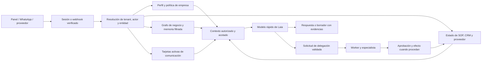

# Agntia Pro · Especificación de servicios y comunicación operativa

**Estado de la decisión.** Propuesta para revisión y ejecución posterior. Los bloques son diseños y ejemplos para implementar. La base inspeccionada es main en 2c46656, junto con la [auditoría del vertical](./ESTADO-VERTICAL-LAIA-Y-DATOS.md). La rama de despliegue y el candidato de núcleo se integrarán por sus propios gates. Las versiones y umbrales que siguen son decisiones iniciales de diseño.

## 1. Qué entregamos al cliente

Una empresa provisionada con usuarios, conexiones y SOPs propios, un panel que muestra sus automatizaciones y un chat con Laia que responde sobre el trabajo con datos verificables. Los especialistas ejecutan operaciones concretas y dejan trazas que el cliente puede consultar. Laia consulta y explica, prepara acciones cuando se le piden y delega a roles acreditados cuando el flujo lo requiere.

| Paquete | Resultado observable | Límites iniciales |
|---|---|---|
| Recepción y citas | Entrada de WhatsApp → intención → disponibilidad → cita confirmada → panel y Laia | Una agenda, una empresa piloto y un canal de escalado humano. Añadir voz después de evaluar transferencias y fallos. |
| Reactivación | Cohorte importada → elegibilidad → contacto aprobado → respuesta → cita u oportunidad | Una cohorte y un canal al principio. Cese inmediato al responder, darse de baja o cambiar de estado. |
| Captación B2B | Descubrimiento → investigación → ficha verificable → aceptación por ventas → oportunidad | Primero entregar fichas revisadas. Cada canal saliente tiene un gate independiente. |
| Supervisión y comunicación | Estado, causas, próximos pasos y borradores redactados con las reglas del cliente | Lectura y preparación como primera versión. Los efectos externos conservan su política de aprobación. |

## 2. Referencias estadounidenses y decisiones de producto

Selección por profundidad de documentación y cercanía al caso de uso. Se revisaron fuentes públicas de los fabricantes. La columna de Agntia es una inferencia de diseño. La comparación no acredita sus métricas, su funcionamiento interno ni superioridad de nuestro piloto.

| Referencia | Comportamiento documentado | Decisión para Agntia | Prueba que exige |
|---|---|---|---|
| Clay · [CRM enrichment](https://university.clay.com/courses/crm-enrichment) y [Signals](https://university.clay.com/docs/signals) | Importa, limpia, enriquece y devuelve datos al CRM. Monitoriza eventos por identificador de empresa o persona y frecuencia configurable. | Guardar hechos por campo con fecha y procedencia. Ejecutar fuentes de coste creciente solo para campos ausentes o caducados. Una señal fechada se conserva separada del perfil estable. | Dos proveedores discrepan. La ficha conserva ambas evidencias, explica la preferencia y no convierte incertidumbre en un dato verificado. |
| 11x · [ICP](https://docs.11x.ai/alice/icp-and-targeting), [Smart Replies](https://docs.11x.ai/alice/smart-replies), [conceptos](https://docs.11x.ai/core-concepts) | Cualifica antes de contactar, excluye estados del CRM y clasifica respuestas con una política de actuación por categoría. La cadencia termina ante respuesta, reunión o descalificación. | Separar ICP, elegibilidad, secuencia y tratamiento de respuesta. Las objeciones sensibles se escalan con contexto. Las categorías se activan gradualmente tras probarlas. | Llega una respuesta mientras el siguiente envío espera. El envío se cancela y el humano recibe un resumen con responsable y siguiente paso. |
| Podium · [AI Employee](https://www.podium.com/product/ai-employee) y [Operator](https://aesthetics.podium.com/resources/podcast/why-every-practice-will-soon-have-an-ai-operator) | Atiende, agenda y reactiva. Su oferta en estética también muestra un asistente interno que consulta datos del negocio. | Dar a Laia la vista operativa y a los especialistas el canal. Ambos comparten referencias acreditadas al mismo resultado. Una cita se declara confirmada desde el registro del calendario. | Tras una cita, Laia explica motivo, estado y registro desde el panel. La empresa vecina no puede resolver el mismo ID. |
| Sierra · [Agent SDK](https://sierra.ai/product/agent-sdk) | Objetivos y guardrails, habilidades componibles, control del grado de determinismo, simulaciones y traspaso con resumen. | Separar plantillas, SOP, política y permiso. Usar redacción flexible en explicaciones y texto aprobado en mensajes críticos. Fijar versiones de configuración y medir regresiones. | Un mensaje del usuario intenta cambiar las reglas de comunicación o activar una herramienta. Se conserva el estilo válido y el permiso del servidor. |
| Regal · [simulaciones](https://developer.regal.ai/docs/test-cases-simulation) y [disposiciones](https://developer.regal.ai/docs/ai-call-dispositions) | Prueba lógica y llamadas a herramientas con conversaciones simuladas. Prioriza resultados de sistema y usa IA cuando no hay regla determinista aplicable. La simulación no sustituye telefonía real. | Primero clasificar hechos del proveedor, después intención. Convertir casos fallidos de producción en fixtures anonimizados. Probar audio y transferencia por separado. | Un traspaso abandonado no cuenta como completado aunque la transcripción diga «te paso con recepción». |
| Retell AI · [flujos de conversación](https://docs.retellai.com/build/conversation-flow/overview) y [extracción posterior](https://docs.retellai.com/features/post-call-analysis) | Nodos, transiciones y subflujos, con resultados posteriores tipados. | Definir estados explícitos para voz y cita. Extraer intención, fecha propuesta y motivo de traspaso. Confirmar el estado con el proveedor o sistema de registro. | Una llamada con dos fechas y una corrección conserva la última fecha aceptada. Solo el ID de reserva acredita éxito. |

El estándar competitivo se comprobará por paquete y escenario. Para afirmaciones comerciales se necesita un piloto medido con línea base, cohorte y coste real. El [benchmark anterior](./BENCHMARK-SERVICIOS-AGNTIA.md) conserva los comparables españoles.

## 3. Cómo discurre la información



### 3.1 Mapa de cambios por archivo

| Archivo actual o propuesto | Responsabilidad y cambio |
|---|---|
| [ChatPanel](../../apps/web/src/components/ChatPanel.tsx) y [ConversationAgent](../../apps/server/src/engine/conversation.ts) | Añadir referencia de automatización desde el panel. El servidor resuelve identidad y autorización. El modelo rápido recibe contexto antes de inferir. Para delegar, el servidor resuelve el rol permitido para el SOP. |
| [ContextEngine](../../apps/server/src/engine/context/engine.ts) y [renderContext](../../apps/server/src/engine/context/assembly.ts) | Pasar entityId acreditado, añadir tarjetas aprobadas y hechos de ejecución, acotar relaciones y eventos por entidad, y separar instrucciones de contenido recuperado. Reusar el presupuesto existente. |
| [BusinessGraph](../../apps/server/src/engine/business/graph.ts) y [Store scoped](../../apps/server/src/db-tenant.ts) | Resolver enlaces de automatización, contacto, campaña y cita. El estado actual viene de la fuente operativa. Las lecturas se autorizan también cuando se ejecutan fuera de la petición. |
| [Perfil Agntia](../../clientes/agntia/agency.json) y [bootstrap](../../scripts/lib/agency-bootstrap.ts) | Provisionar referencias de tarjetas aprobadas y su titular. Propuesta de archivo clientes/agntia/communication-cards.json. La semilla debe distinguir instalación inicial de publicación de una nueva versión. |
| [Esquema SOP](../../packages/domain/src/sop.ts), [SOPs de Agntia](../../clientes/agntia/sops.ts) y [ejecutor](../../apps/server/src/engine/sop-executor.ts) | Reusar el enum de herramientas. Adjuntar políticas y tarjetas a la configuración versionada del flujo. Una herramienta nueva exige implementación y aceptación explícitas. |
| [Servicio de tareas](../../apps/server/src/engine/service.ts), [worker](../../apps/server/src/engine/worker.ts) y [WhatsApp outbound](../../apps/server/src/engine/whatsapp-outbound.ts) | Persistir identidad, versión y evidencias. Reusar el circuito de revisión del envío cuando aplique. Vincular la aprobación al contenido, destinatario, canal, conexión y expiración. |
| Propuesta packages/domain/src/communication-card.ts y apps/server/src/engine/context/communication-cards.ts | Contrato, selección y validación. Empezar con un módulo pequeño y una semilla por empresa. Evitar un segundo motor de prompts o un CMS hasta que exista un caso de uso. |

### 3.2 Qué recibe el fast y en qué orden

1. **Política de servidor.** Identidad verificada, alcance del rol, herramientas habilitadas y límites que el modelo no puede ampliar.
2. **Tarjetas.** Una tarjeta base de Laia y una del caso de uso como presupuesto inicial. El servidor elige por intención, rol, canal, estado, idioma y empresa. Los scripts fijos se renderizan en servidor.
3. **Hechos operativos autorizados.** IDs de fuentes, fechas, estados y cifras calculadas fuera del LLM. Una cifra incluye periodo, zona horaria y denominador cuando aplica.
4. **Conocimiento recuperado.** Perfil, documentos, extractos de correo y web como datos. No aceptar instrucciones incrustadas. Dejar fuera secretos, credenciales y campos no autorizados.
5. **Pregunta e historial necesario.** Para «esta campaña» usar la entidad autorizada del hilo. Para nombres ambiguos, pedir aclaración.

El grafo empresarial aporta enlaces. Calendar, el CRM o la operación persistida acreditan el resultado. El grafo cognitivo guarda turnos y sirve a Presenter y supervisión. La propuesta no incorpora pensamientos internos al prompt ni los expone al cliente.

## 4. Tarjetas de comunicación validadas

Una tarjeta enseña a un agente **cómo informar o pedir algo en un contexto**. Un SOP define el proceso y sus transiciones. Una política decide si una acción está permitida. Un hecho aporta evidencia. Las cuatro piezas tienen ciclos de vida distintos.

### 4.1 Contrato de configuración propuesto

```ts
import { z } from "zod";

const communicationCardSchema = z.object({
  id: z.string().regex(/^[a-z0-9-]+$/).max(80),
  version: z.number().int().positive(),
  status: z.enum(["draft", "approved", "retired"]),
  locale: z.enum(["es-ES", "en-US"]),
  channels: z.array(z.enum(["panel", "email", "whatsapp", "voice"])).min(1),
  roleIds: z.array(z.string().min(1)).min(1),
  intents: z.array(z.string().min(1)).min(1),
  sopIds: z.array(z.string().min(1)),
  states: z.array(z.string().min(1)),
  priority: z.number().int().min(0).max(100),
  mode: z.enum(["guided", "fixed"]),
  structure: z.array(z.string().max(150)).min(1).max(6),
  requiredFacts: z.array(z.string().max(80)).max(12),
  forbiddenClaims: z.array(z.string().max(180)).max(10),
  template: z.string().max(600),
  missingFactScript: z.string().min(1).max(240),
  fallback: z.enum(["explain_missing", "ask", "escalate"]),
}).strict();

type Card = z.infer<typeof communicationCardSchema>;
type PublishedCard = {
  tenantId: string;
  card: Card;
  approvedBy: string;
  approvedAt: string;
  contentHash: string;
};
```

La fila de publicación se escribe desde sesión autorizada y guarda la revisión inmutable. La empresa viene del Store y del contexto acreditado. El JSON del cliente no asigna propietario ni privilegios. La fecha, el aprobador y el hash se registran en servidor.

### 4.2 Selección y ejecución

```ts
type Match = {
  tenantId: string;
  roleId: string;
  locale: Card["locale"];
  channel: Card["channels"][number];
  intent: string;
  sopId?: string;
  state?: string;
};

function selectCard(active: readonly PublishedCard[], m: Match) {
  return active
    .filter(({ tenantId, card }) =>
      tenantId === m.tenantId &&
      card.status === "approved" &&
      card.locale === m.locale &&
      card.channels.includes(m.channel) &&
      card.roleIds.includes(m.roleId) &&
      card.intents.includes(m.intent) &&
      (!card.sopIds.length || (!!m.sopId && card.sopIds.includes(m.sopId))) &&
      (!card.states.length || (!!m.state && card.states.includes(m.state))))
    .sort((a, b) => b.card.priority - a.card.priority ||
      a.card.id.localeCompare(b.card.id))[0];
}
```

El repositorio de tarjetas devuelve exclusivamente la revisión activa por ID. Publicar falla si dos tarjetas de igual prioridad empatan sobre el mismo caso. Seleccionar el bloque desde el conjunto autorizado mantiene estable la política incluso si el clasificador de intención se equivoca. El actor no puede obtener más permisos cambiando intención o canal en la petición.

En modo guided se pasan estructura, restricciones y hechos al fast para redactar. En modo fixed el servidor interpola únicamente slots definidos y aprobados, valida tipo, longitud y escape para el canal y emite el texto. Si falta un hecho requerido, usar el fallback. La reserva y el envío siguen pasando por herramientas autorizadas. Un resultado del modelo inválido no puede disparar efectos.

```ts
type Fact = {
  ref: string;
  kind: "operation" | "crm" | "calendar" | "policy" | "document";
  observedAt: string;
  value: string | number | boolean;
};

type FastReply = {
  answer: string;
  evidenceRefs: string[];
  next: "none" | "ask" | "draft" | "escalate";
};
```

El servidor verifica que evidenceRefs pertenezca al conjunto entregado y que next esté permitido para el contexto. La traza registra IDs, versiones, intención, referencias y resultado de validación. Los textos crudos y las transcripciones requieren una política de acceso y retención separada.

### 4.3 Biblioteca inicial para aprobar con cada empresa

| ID y modo | Cuándo | Método o script inicial | Reglas de validación |
|---|---|---|---|
| laia-estado-operacion · guided | Panel, consulta de estado | «Estado actual → qué lo explica → dato con hora y enlace → siguiente paso y responsable». | Si hay varias ejecuciones, identifica cuál. Sin hora o evidencia no atribuye una causa. |
| laia-resumen-metricas · guided | Panel, balance de campaña | «Periodo y alcance → cifras → comparación → incidencias → decisión pendiente». | Usa agregados acreditados. Distingue citas propuestas, confirmadas y celebradas. |
| cita-propuesta · fixed | WhatsApp o email, disponibilidad verificada | «Tengo disponible {{fecha_hora_local}}. ¿Te encaja?» | Exige disponibilidad reciente. Nunca usa «reservada» en este estado. |
| cita-confirmada · fixed | WhatsApp, reserva persistida | «Tu cita está confirmada para {{fecha_hora_local}}. Tu referencia es {{referencia_cita}}.» | Exige ID y estado confirmado del sistema de agenda. Si el resultado es ambiguo, pasa a revisión. |
| reactivacion-primer-toque · guided | Contacto elegible, borrador | «Referencia legítima a la relación anterior → motivo actual → pregunta breve». | No usar inferencias sensibles ni urgencia inventada. Verificar elegibilidad inmediatamente antes del envío. |
| objecion-sensible · guided | Venta, precio excepcional, legal o promesa | «Reconocer → decir qué podemos confirmar → traspasar con contexto». | Laia usa precios aprobados. El comercial recibe pregunta, hechos y plazo si existe. |
| entrega-lead · guided | Panel, ficha para ventas | «Quién es → por qué encaja → evidencia → incertidumbre → siguiente acción». | Al menos una fuente verificable. Si no hay contacto fiable, la ficha queda en investigación. |
| sin-evidencia · fixed | Panel, fuente no disponible | «Aún no puedo verificar ese dato. Puedo indicarte dónde consultarlo o dejarlo pendiente de revisión.» | Sin cifras ni confirmaciones. La UI distingue dato ausente de acceso denegado según política. |
| transferencia-voz · fixed | Voz, paso a humano | «Te paso con el equipo de {{equipo}} para que revise tu caso.» | Si la transferencia falla, se ofrece devolución de llamada según política. Medir conexión efectiva. |

### 4.4 Ejemplo de ficha por empresa

```json
{
  "id": "cita-confirmada",
  "version": 1,
  "status": "draft",
  "locale": "es-ES",
  "channels": ["whatsapp"],
  "roleIds": ["recepcion"],
  "intents": ["informar-cita"],
  "sopIds": ["recepcion-agenda"],
  "states": ["confirmed"],
  "priority": 60,
  "mode": "fixed",
  "structure": ["fecha y hora", "referencia"],
  "requiredFacts": ["fecha_hora_local", "referencia_cita"],
  "forbiddenClaims": ["prometer cambios fuera del calendario"],
  "template": "Tu cita está confirmada para {{fecha_hora_local}}. Tu referencia es {{referencia_cita}}.",
  "missingFactScript": "Todavía estoy verificando la reserva.",
  "fallback": "escalate"
}
```

Los IDs recepcion y recepcion-agenda son ilustrativos. Resolver sus equivalentes contra el catálogo efectivo del cliente antes de activar la tarjeta. La publicación valida placeholders contra requiredFacts y exige casos de ejemplo aprobado y de ausencia de datos. El responsable de la empresa aprueba tono y límites. El responsable técnico valida el enlace con herramientas y estados. Un cambio crea revisión nueva. Una retirada vuelve a la revisión aprobada anterior o al fallback. Las tareas persistidas conservan las referencias de la revisión que usaron.

## 5. Boilerplates de SOP y pipeline

### 5.1 SOP inicial ejecutable en modo de propuesta

Este ejemplo usa solo tools presentes en el enum actual. Verificar que el contrato de entrada del endpoint aporta los campos previstos antes de habilitarlo. La validación de slots y la confirmación son etapas distintas.

```ts
import { sopSchema } from "../../packages/domain/src/sop.ts";

export const receptionAppointmentDraft = sopSchema.parse({
  id: "recepcion-cita-propuesta",
  name: "Preparar cita desde recepción",
  category: "Recepción",
  active: false,
  trigger: { type: "api", value: "" },
  allowedTools: ["prepare_event", "save_artifact"],
  steps: [
    {
      id: "propuesta",
      title: "Preparar cita",
      tool: "prepare_event",
      params: {
        calendarId: "{{input.calendarId}}",
        title: "{{input.title}}",
        start: "{{input.start}}",
        end: "{{input.end}}",
        timeZone: "Europe/Madrid",
      },
    },
    {
      id: "evidencia",
      title: "Guardar la referencia de preparación",
      tool: "save_artifact",
      params: {
        kind: "report",
        title: "Cita propuesta",
        summary: "Pendiente de revisión",
        data: { bookingId: "{{input.bookingId}}" },
      },
    },
  ],
});
```

El servicio resuelve calendarId desde la conexión del tenant. Valida inicio, fin, tipo de cita y disponibilidad. Confirmar la reserva requiere un efecto separado y un resultado de Calendar o CRM persistido. El artefacto «Cita propuesta» nunca cuenta como confirmación.

### 5.2 Recepción y agenda

| Paso | Entrada y salida | Excepción o aceptación |
|---|---|---|
| Recibir | Evento firmado → inbox con empresa, canal y ID externo | Dos entregas del mismo evento producen una entrada y un resultado. |
| Entender | Clasifica consulta, cita, cambio, cancelación o humano | Baja confianza o petición sensible → traspaso con responsable. |
| Consultar | Lee servicios, duración, horario, buffers y disponibilidad real | Revalida slot al confirmar. Dos solicitudes para el mismo slot dejan un único resultado compatible. |
| Preparar | Crea booking en estado proposed y una intención de efecto | Versión de la tarjeta y huella de los campos revisados quedan registradas. |
| Confirmar | Aplica autorización, escribe en agenda y guarda ID externo | En caso de timeout con resultado desconocido, entra en reconciliación. |
| Informar | Envía confirmación desde el canal correcto y expone resultado a Laia | El mensaje solo usa cita-confirmada con evidencia de proveedor. |
| Cambiar o cancelar | Resuelve la cita existente y valida política de modificación | Conserva relación entre versiones y notifica cuando el nuevo estado se acredita. |

### 5.3 Reactivación

| Paso | Implementación propuesta |
|---|---|
| Importar | Recibir un lote con origen y fecha. Normalizar identidad y revisar coincidencias dudosas. Preservar la fila de origen sin multiplicar contactos. |
| Elegibilidad | Consultar política del tenant, canal, exclusiones, bajas, contacto válido y oportunidades activas. El filtro corre antes de preparar y antes de enviar. |
| Cohorte | Congelar el criterio, registrar tamaño y asignar control cuando sea viable. Mantener fija la cohorte para comparar resultados. |
| Cadencia | Persistir paso, hora, próxima ejecución y límite. Acotar volumen y horario. Releer la actividad del contacto antes de cada paso. |
| Respuesta | Guardar el evento y parar cadencia. Clasificar interés, objeción, rechazo, baja o derivación. Verificar los resultados duros en Store. |
| Resultado | Registrar reunión confirmada y celebrada, oportunidad y margen. Atribuir ingresos con una regla acordada y medir incrementalidad con el control. |

### 5.4 Captación B2B

1. Descubrir candidatos desde Places u otra fuente autorizada. Dedupe por identificador de proveedor y dominio normalizado. Conservar las fusiones y sus evidencias.
2. Enriquecer con campos explícitos. Priorizar CRM y web de empresa, luego otras fuentes autorizadas según coste y frescura. Guardar campo, valor, fuente, observación y confianza. Mantener los desacuerdos sin inventar el dato faltante.
3. Evaluar exclusiones antes del score. Puntuar ICP con reglas revisables de sector, geografía, tamaño aproximado y necesidad observable. La explicación indica qué regla y fuente aportaron el punto.
4. Producir ficha y un borrador corto basado en un hallazgo verificable. El comercial acepta, devuelve para revisión o rechaza con motivo. Aprobación de la ficha y autorización de contacto son decisiones distintas.
5. Tratar señales, respuestas y reuniones como eventos. Conservar el estado por campaña y contacto. Evitar contabilizar un contacto duplicado o una cita cancelada como oportunidad nueva.

### 5.5 Voz y handoff

Usar Vapi como primer adaptador existente una vez corregida la idempotencia. Empezar por recepción en entorno de prueba con número controlado. Separar los estados de proveedor de la intención extraída. Guardar resultado, razón, referencia de reserva si existe y referencia de transferencia. Medir la transferencia iniciada, conectada y abandonada por separado. Voz saliente queda detrás de su propio gate y validación de proveedor.

### 5.6 Máquina de efectos común

```ts
type EffectStatus =
  | "draft" | "pending_approval" | "approved"
  | "dispatching" | "confirmed" | "rejected" | "unknown";

type EffectIdentity = {
  tenantId: string;
  operationId: string;
  revision: number;
  effectKind: "book" | "send" | "call";
  connectionGeneration: string;
  payloadHash: string;
};
```

Usar una restricción única o una reserva CAS antes de llamar al proveedor. El evento entrante y el efecto saliente tienen claves distintas. Cambiar destinatario, texto, cita o conexión invalida la aprobación anterior. Si se corta el proceso entre la aceptación del proveedor y el guardado, registrar unknown o detectar un dispatching vencido. Reconciliar consultando el proveedor o por operación humana acreditada. Solo repetir automáticamente cuando el proveedor garantiza idempotencia para esa clave o se comprueba ausencia del efecto anterior.

## 6. Panel, observabilidad y evidencia

Cada tarjeta de automatización muestra objetivo, estado, último resultado, próximas ejecuciones, errores y aprobaciones pendientes. Desde ahí se abre Laia con el contexto de la tarjeta. El panel permite ir desde una respuesta a la ejecución, el paso y la evidencia que puede ver el usuario.

| Evento propuesto | Campos mínimos | Uso |
|---|---|---|
| ingest.accepted / ingest.duplicate | tenant, canal, ref externa, traceId | Disponibilidad y dedupe de entrada. |
| context.assembled | traceId, actor, rol, SOP y tarjeta con versión, refs, latencia | Depurar qué contexto se entregó sin registrar todo el prompt. |
| operation.transition | tenant, run, paso, estado anterior y nuevo, motivo | Explicar fallos y construir panel. |
| effect.reconciled | operación, revisión, resultado, referencia externa | Resolver estados desconocidos y auditar duplicados. |
| human.handoff | destino, razón, aceptadoEn, cerradoEn | Medir tiempos y comprobar que existe un humano que recoge el caso. |

Reusar el bus y las trazas disponibles. Los eventos de ejemplo son nombres propuestos. Añadirlos al contrato solo cuando haya productor, consumidor o evidencia de aceptación. Medir latencia p50/p95 por canal, coste de proveedor por resultado, cola de aprobación, efectividad de traspaso y fallos de reconciliación. Para voz, validar telefonía real además de la simulación.

### 6.1 Evaluación y promoción

| Caso | Aserción de salida |
|---|---|
| Respuesta con documento malicioso | La respuesta usa datos permitidos y no adopta instrucciones incrustadas. |
| IDs iguales en dos empresas y cambio de empresa en sesión | Solo consulta, ejecución y traza del ámbito autorizado. Repetir con reinicio del worker y PostgreSQL con RLS. |
| Agenda en zona horaria incorrecta o cambio horario | Slot y mensaje coinciden con el calendario y la zona declarada. |
| Callback duplicado y fallo tras efecto | Un efecto externo máximo cuando el proveedor lo garantiza. En caso ambiguo, estado visible y reconciliación. |
| Tarjeta editada durante aprobación | Se conserva el borrador con revisión anterior o se exige nueva aprobación, según el cambio. |
| Usuario se da de baja mientras espera un contacto | El siguiente envío se cancela y queda evidencia de la exclusión. |
| Traspaso de voz fallido | No se cuenta como conectado. La cola humana recibe el caso de acuerdo con la política. |
| Laia explica una cifra | Cita periodo y registro correctos. Si no dispone de él, usa fallback y no inventa. |

Antes de ampliar volumen, ejecutar escenarios con fixtures, prueba de herramientas, smoke con proveedor de prueba y piloto con usuarios autorizados. Cero efectos no aprobados y cero accesos cruzados son gates de aceptación. Para métricas como exactitud de respuesta, latencia y conversión, acordar objetivos y tamaño de muestra con el cliente antes de prometer resultados.

## 7. Secuencia de implementación

| Fase | Entregable | Criterio de salida |
|---|---|---|
| 0 · Base | Reconciliar cambios de Freebuff, VS-01 y núcleo. Inventariar SHA, imagen y conexión por proceso. | OAuth comprobado y evidencia de aislamiento en tareas, reinicio y credenciales. |
| 1 · Laia en lectura | Tarjeta de automatización, resolución segura, contexto operativo, dos tarjetas guiadas y trazas. | El cliente explica un bloqueo y una métrica con referencias. Prueba cruzada sin exposición. |
| 2 · Recepción | WhatsApp entrante, disponibilidad, reserva controlada, confirmación y handoff. | Caso normal, slot ocupado, duplicado y fallo del proveedor. Resultado visible y explicable. |
| 3 · Reactivación | Importador, exclusiones, cadencia y clasificación de respuestas. | Un lote controlado con bajas, respuesta concurrente, cohorte y coste atribuible. |
| 4 · Captación | Places, enriquecimiento, ICP y ficha entregable. | Ventas acepta fichas con evidencia, revisa descartes y mide reuniones celebradas. |
| 5 · Voz | Recepción, transferencia, disposiciones y evaluación. | Prueba telefónica real, resultado verificable y coste por caso resuelto. |

### 7.1 Primer encargo al ejecutar

Empezar con la fase 1 cuando el contexto de identidad de fase 0 sea verificable. Entregar un único recorrido de lectura usando la tarjeta laia-estado-operacion y una automatización conocida de Agntia. Aportar evidencia de qué archivos, campos y versiones llegaron al fast. Usar una segunda empresa en fixtures. En la misma revisión comprobar que el chat existente sigue funcionando sin tarjeta y que un usuario sin permiso recibe el resultado previsto. La primera PR no necesita escribir en Calendar ni introducir una nueva red de agentes.

### 7.2 Qué debe aportar cada empresa

Catálogo de servicios y precios autorizados, horarios y excepciones, objetivos de cada automatización, contactos para escalado, criterio de elegibilidad, reglas de aprobación, vocabulario y ejemplos de mensajes aceptados y rechazados. Añadir IDs de agenda o CRM por canal, identidad visual y retención acordada. Entregar accesos por su mecanismo de secretos o consentimiento. En Git solo se guarda configuración aprobada sin credenciales ni datos reales de clientes.

## 8. Plantilla de activación y fixture

El manifiesto de la automatización declara sus dependencias. El bootstrap valida las referencias contra el catálogo del tenant y conserva el modo de solo lectura cuando la entrega se limita a Laia.

```yaml
id: recepcion-agenda
version: 1
mode: read_only
ownerRole: recepcion
supervisorRole: laia
sources:
  operationalState: booking
  policy: agenda-recepcion
cardRefs:
  - id: laia-estado-operacion
    version: 1
effectPolicy:
  booking: approval_required
  outbound: approval_required
acceptanceSuite: reception-agenda-v1
```

Fixture mínimo para verificar que una propuesta de cita no se presenta como reserva. Repetir con el mismo ID en otra empresa y con una fuente documental que afirma falsamente que la cita se confirmó.

```json
{
  "id": "laia-no-confirma-propuesta",
  "tenant": "fixture-empresa-a",
  "question": "¿Está confirmada la cita de mañana?",
  "facts": [{ "ref": "booking-fixture-42", "status": "proposed" }],
  "expected": {
    "allowedEvidenceRefs": ["booking-fixture-42"],
    "forbiddenCardIds": ["cita-confirmada"],
    "externalEffects": 0,
    "meaning": "La cita está propuesta y aún no está confirmada."
  }
}
```
